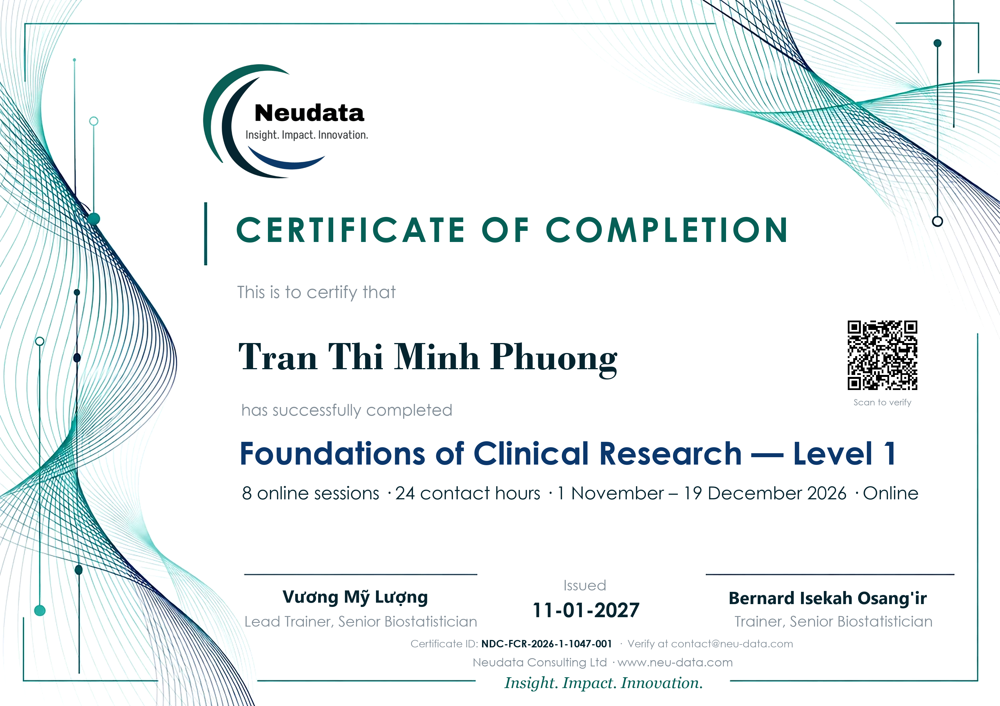

# Certificate portal: Foundations of Clinical Research — Level 1

The same portal as *Clinical Data Analysis in R — Phase I* (see [`../../README.md`](../../README.md)), with this course's details. It runs as its **own** Apps Script project, so the two courses keep separate eligible lists, registers and certificate IDs.



| | |
|---|---|
| Course | Foundations of Clinical Research — Level 1 |
| Printed details | 8 online sessions · 24 contact hours · 1 November – 19 December 2026 · Online |
| Issue date | 11-01-2027 (certificates go out after the revision deadline, 9 January 2027) |
| Certificate IDs | `NDC-FCR-2026-1-10XX-NNN` |
| Trainers | Vương Mỹ Lượng (Lead Trainer), Bernard Isekah Osang'ir (Trainer) |
| Survey code | `NDC-FCR-SURVEY-2026` (shown when the course evaluation form is submitted) |

## Who goes on the eligible list

Add a participant only when all five course conditions are met: attendance at 6 or more of the 8 sessions, the proposal and slides (19 December), the Results draft (20 December), the review of a classmate's draft (30 December 2026), and the revised Results section and response (9 January 2027).

## Drive

It uses the same **Neudata Certificates** folder as the other course, so the trainers' signature files (`signature-my-luong.png`, `signature-bernard.png`) are shared. Everything else has its own name:

```
Neudata Certificates/
├── FCR Level 1 · Eligible participants/     ← one .txt file per eligible person (same rules as the other course)
├── FCR Level 1 · Issued certificates/
├── FCR Level 1 · Certificate register
├── FCR Level 1 · Certificate template (do not delete)
└── FCR Level 1 · Course evaluation          ← Google Form made by setupSurvey()
```

## One-time setup (about 10 minutes)

Signed in as **b.osangir@gmail.com**:

1. <https://script.google.com> → **New project**, named *Neudata certificate portal · FCR Level 1*.
2. **Project Settings** → tick **Show "appsscript.json" manifest file in editor**.
3. Paste the files from [`apps-script/`](apps-script/): `appsscript.json`, `Code.gs`, a new script file `Survey.gs`, and HTML files `Portal`, `Verify` and `Submit`.
4. Run **`setup`**, approve the permissions. It creates the folders and the certificate template from [`certificate-template.pptx`](certificate-template.pptx).
5. Run **`setupSurvey`**, approve the Forms permission. The log shows the evaluation form link: use it for the course evaluation in Session 8 too.
6. **Deploy → New deployment → Web app**, *Execute as:* Me, *Who has access:* Anyone. Copy the Web app URL: this is the certificate link for participants.
7. Test: run `addMeToEligibleList`, open the URL, submit the survey, generate your certificate, then run `voidMyCertificate`.

Send the Web app URL to Bernard to add a certificate page to the course website.

## Changing it

| What | Where |
|---|---|
| Printed course text, dates, issue date | `background` in [`course.json`](course.json), then `python portal/make_background.py courses/fcr-level1`, push, and run `setup` again |
| Emails, portal pages, folder names, ID prefix | `portal` in [`course.json`](course.json), then `python portal/make_course.py courses/fcr-level1` and paste the changed files into the project |
| Survey questions | [`Survey.gs`](Survey.gs) (before running `setupSurvey`) |
| Preview | `python portal/preview.py "Participant Name" courses/fcr-level1 NDC-FCR-2026-1-1047-001` |

The preview uses a local font without Vietnamese accents; the real certificate sets the name in Google Slides, which shows them.

When the shared portal files change, run `make_course.py` again: it stops if one of this course's replacements no longer matches.
